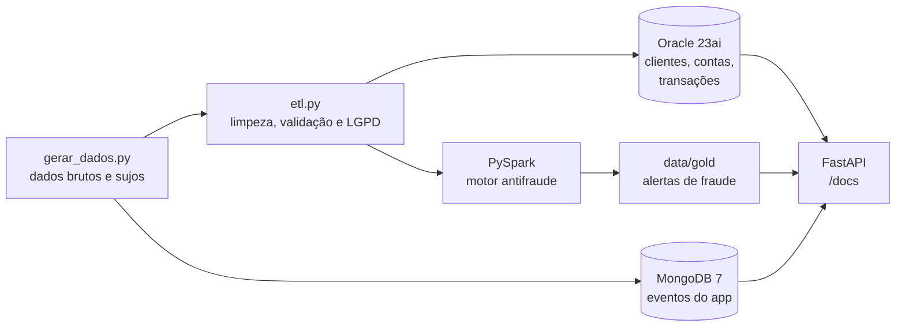

# 🏦 Bank Data Pipeline — Engenharia de Dados para Antifraude Bancária


Pipeline de dados **ponta a ponta** simulando o ambiente de um banco digital: dados brutos e "sujos" de transações passam por **ETL com tratamento de LGPD**, são carregados em **Oracle** (dados transacionais) e **MongoDB** (eventos do app), processados por um **motor antifraude em PySpark** e expostos por uma **API FastAPI** — tudo orquestrado com **Docker Compose**.

> Todos os dados são **sintéticos**, gerados pelo próprio projeto. Nenhum dado real de cliente é utilizado.

---

## 📐 Arquitetura



| Camada | Tecnologia | Responsabilidade |
|---|---|---|
| Ingestão | Python | Gera 500 clientes, 641 contas, 45 mil transações e 8 mil eventos com problemas reais de qualidade |
| ETL | Python + pandas | Padronização, deduplicação, validação de CPF, mascaramento e hash (LGPD) |
| Dados transacionais | Oracle 23ai | Modelo relacional com PK, FK, CHECK e índices; consultas analíticas em SQL |
| Dados semiestruturados | MongoDB 7 | Eventos com esquema variável; aggregation pipelines |
| Processamento | PySpark 4.0 | Perfil por cliente (window functions + z-score) e nota de risco por transação |
| Exposição | FastAPI | API REST que integra as três fontes, com documentação Swagger |
| Infraestrutura | Docker Compose | Ambiente completo reproduzível com um comando |

---

## 📊 Resultados

### Qualidade de dados (ETL)

| Problema encontrado na origem | Ocorrências | Tratamento |
|---|---:|---|
| Transações duplicadas | 451 | Removidas por `transacao_id` |
| Tipo de transação inconsistente (`pix`, ` Pix `) | 6.685 | Padronizado em maiúsculas |
| Valor no formato brasileiro (`1.250,90`) | 9.008 | Convertido para número |
| Data em formato brasileiro (`01/08/2026`) | 11.240 | Unificado em ISO |
| Canal vazio | 916 | Preenchido como `desconhecido` (transação mantida) |
| CPF com pontuação / inválido | 197 / 7 | Normalizado, validado, **mascarado e anonimizado** |

O pipeline **interrompe a carga** se alguma regra de validação falhar, e a carga no Oracle é **atômica** (commit somente se a contagem conferir; caso contrário, rollback).

### Detecção de fraude

| Abordagem | Onde | Precisão | Recall |
|---|---|---:|---:|
| Regra SQL com CTE (PIX de madrugada > 5× a média do cliente) | Oracle | 100% | 86% |
| Nota de risco multissinal (madrugada, z-score, cidade, PIX) | PySpark | 100% | 100% |

> ⚠️ **Nota honesta:** os resultados refletem os dados sintéticos — no gerador, transações legítimas não ocorrem de madrugada, o que torna esse sinal muito forte. Com dados reais, seria esperado um trade-off entre precisão e recall, e os pesos precisariam ser calibrados com histórico (ou substituídos por um modelo de machine learning).

---

## 🚀 Como executar

**Pré-requisitos:** Python 3.10+ e Docker Desktop.

```bash
# 1. Configurar variáveis de ambiente
cp .env.example .env            # no Windows: copy .env.example .env

# 2. Ambiente Python
python -m venv .venv
source .venv/bin/activate       # no Windows: .venv\Scripts\activate
pip install -r requirements.txt

# 3. Gerar os dados e rodar o ETL
python scripts/gerar_dados.py
python scripts/etl.py

# 4. Subir Oracle, MongoDB e API (aguarde todos ficarem "healthy")
docker compose up -d --build
docker compose ps

# 5. Carregar os bancos
python scripts/carregar_oracle.py
python scripts/carregar_mongo.py

# 6. Rodar o motor antifraude (Spark dentro do Docker, sem instalar Java)
docker compose run --rm spark
```

Acesse a documentação interativa da API em **http://localhost:8000/docs**.

---

## 🔌 Endpoints da API

| Método | Endpoint | Fonte | Descrição |
|---|---|---|---|
| GET | `/health` | Todas | Status das conexões |
| GET | `/clientes/{id}` | Oracle | Cadastro do cliente (CPF mascarado) |
| GET | `/clientes/{id}/extrato` | Oracle | Extrato com saldo acumulado (window function) |
| GET | `/clientes/{id}/eventos` | MongoDB | Eventos do app, com filtro por tipo |
| GET | `/alertas-fraude` | Spark | Transações suspeitas por nota de risco |
| GET | `/clientes/{id}/risco` | Spark + MongoDB | Visão 360° de risco do cliente |

Exemplo — `GET /clientes/14/risco`:

```json
{
  "cliente_id": 14,
  "alertas_spark": 1,
  "maior_nota_risco": 100,
  "trocou_celular": true,
  "aumentou_limite_pix": true,
  "logins_falhos": 0,
  "nivel_risco": "CRÍTICO"
}
```

---

## 🗂️ Estrutura do projeto

```
bank-data-pipeline/
├── api/
│   ├── main.py                 # API FastAPI (Oracle + MongoDB + Spark)
│   ├── Dockerfile              # Imagem slim da API
│   └── requirements.txt
├── scripts/
│   ├── gerar_dados.py          # Geração de dados sintéticos com problemas de qualidade
│   ├── etl.py                  # ETL: limpeza, validação e LGPD
│   ├── carregar_oracle.py      # Carga em lotes com bind variables e commit atômico
│   ├── carregar_mongo.py       # Carga de eventos + aggregation pipelines
│   └── antifraude_spark.py     # Motor de nota de risco em PySpark
├── sql/
│   ├── 01_criar_tabelas.sql    # Modelo relacional (PK, FK, CHECK, índices)
│   └── 02_consultas.sql        # JOIN, window functions, RANK, subconsulta e CTE
├── docker-compose.yml          # Oracle, MongoDB, API e job Spark
├── .env.example                # Modelo de variáveis de ambiente
└── requirements.txt
```

---

## 🧠 Decisões técnicas

- **LGPD desde a ingestão:** o CPF aberto nunca sai do ETL. Ficam apenas a versão mascarada (`***.181.960-**`) e um hash **HMAC-SHA256 com chave secreta** — um SHA-256 simples seria reversível por força bruta, já que existem apenas ~10⁹ CPFs possíveis.
- **Oracle para transações, MongoDB para eventos:** dados transacionais exigem integridade referencial; eventos do app têm campos diferentes por tipo, e no modelo relacional virariam colunas majoritariamente nulas.
- **Validação em duas camadas:** as regras do ETL (`assert`) se repetem como `CHECK` constraints no Oracle — nenhum sistema consegue gravar dado inválido, mesmo fora do pipeline.
- **Segurança na carga e na API:** bind variables em todas as consultas (proteção contra SQL injection), credenciais apenas em variáveis de ambiente e pool de conexões na API.
- **Perfil relativo ao cliente:** o motor antifraude compara cada transação com o padrão do próprio cliente (z-score), não com um valor fixo — R$ 10 mil é normal para um cliente e atípico para outro.
- **Reprodutibilidade:** semente aleatória fixa, ambiente 100% em Docker e Spark executado em container (sem instalação de Java na máquina).

---

## 🔭 Próximos passos

- Orquestrar o pipeline com **Apache Airflow**
- Ler o Oracle diretamente no Spark via **JDBC** e gravar os alertas de volta no banco
- Substituir a nota por regras por um modelo de **machine learning** (ex.: Isolation Forest)
- Adicionar **testes automatizados** (pytest) e **CI** com GitHub Actions
- Regra de account takeover com **janela de tempo** (troca de dispositivo + aumento de limite em até 24h)

---

## 👤 Autor

**Leander Carvalho** — [LinkedIn](https://www.linkedin.com/in/leander-carvalho)
